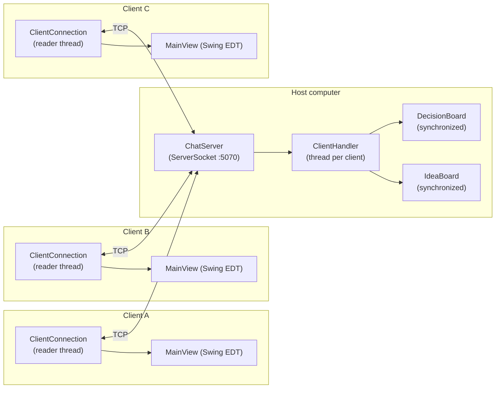

# Research Partners

**ITAS1 Final Project - Network Programming | Java LAN Chat Application (by pair)**

Research Partners is a Java group-chat application for **student research teams**. It runs over a local network
(LAN / Wi-Fi) using plain TCP sockets, with one multi-threaded server and Swing graphical clients. Besides normal
group chat, it adds two shared research tools: **idea cards with categories** and **group decisions with recorded votes**.

---

## Table of Contents

1. [Project Information](#1-project-information)
2. [Concept Proposal and Approval](#2-concept-proposal-and-approval)
3. [User Problem and Theme](#3-user-problem-and-theme)
4. [Features](#4-features)
5. [Architecture and Message Format](#5-architecture-and-message-format)
6. [Setup Instructions](#6-setup-instructions)
7. [Commands](#7-commands)
8. [Screenshots](#8-screenshots)
9. [Test Results](#9-test-results)
10. [Contribution Log](#10-contribution-log)
11. [Credits, Reused Libraries and AI Assistance](#11-credits-reused-libraries-and-ai-assistance)

---

## 1. Project Information

| | |
|---|---|
| **Project name** | Research Partners |
| **Course / Section** | ITAS1 - Network Programming / BSIT-2BSD |
| **Instructor** | Kenth Joshua Espina |
| **Partner 1** | John Martin Sodusta - GitHub: [`@dakila234`](https://github.com/dakila234) |
| **Partner 2** | Krishna Pauligue - GitHub: [`@krishnapauligue`](https://github.com/krishnapauligue) |
| **Repository** | [ITAS1-ReseachPartner-by-John-Martin-Sodusta-and-Krishna-Pauligue](https://github.com/dakila234/ITAS1-ReseachPartner-by-John-Martin-Sodusta-and-Krishna-Pauligue) |
| **Final commit hash** | ed710642cb9f382c9d65d6536254252b5179d245 |
| **Technology** | Java SE (JDK 11+), Swing (JFrame), `java.net.Socket` / `ServerSocket`, Apache NetBeans (Ant) |

---

## 2. Concept Proposal and Approval

| | |
|---|---|
| **Audience** | Student research teams (thesis or class research groups) |
| **Problem** | Ideas get lost in a busy chat, and nobody can prove who agreed to which decision. |
| **Feature 1** | **Idea cards with categories** (Hypothesis / Method / Source / Question) on a shared board. "Decide" turns a card into a vote. |
| **Feature 2** | **Group decisions with recorded votes** - names shown per option, votes changeable until closed, recorded outcome (winner / tie / no votes). |
| **Sample screens** | See [Screenshots](#8-screenshots): join screen, Idea Board, Decisions, chat |
| **Instructor approval** | Approved by: Kenth Joshua Espina &nbsp;&nbsp; Date: `<date approved>` |

---

## 3. User Problem and Theme

**Theme:** Research Partners (from the suggested themes: *Idea cards with categories; group decisions with recorded votes*).

**User problem.** Research teams brainstorm in chat, but in an ordinary messaging app:

- good ideas scroll away and are never organised (hypothesis vs. method vs. source vs. open question);
- "we agreed to use the survey" is easy to dispute later because nothing records who agreed.

**How this application helps beyond ordinary messaging.** Ideas are pinned to a shared board sorted by category,
and any idea can be put to a vote. Every vote is recorded **by name**, can be changed until the owner closes the
vote, and closing stores the outcome for everyone. Each person also has their own colour across the chat, online
list, idea lists and vote records, so it is easy to see who said or voted what.

---

## 4. Features

### Core features (required)

| Requirement | How it is implemented |
|---|---|
| Server and concurrent clients | `ChatServer` accepts connections; one `ClientHandler` thread per client. At least three clients at once; one disconnecting does not stop the server or the others. |
| Real LAN communication | The join screen takes the server **IP address and port** (default `5070`). The Host Console shows the host computer's IP addresses. |
| Graphical chat interface (Swing) | Connection controls, nickname field, message input with Send button, conversation area and online user list. |
| Group chat | Each message is broadcast once to every connected client, including the sender, with **sender nickname and time (HH:mm)**. Messages stay in the conversation area for the session. |
| User identity and commands | Non-blank, unique (case-insensitive) nicknames, validated on join. See [Commands](#7-commands). Join and leave notices and the online list update for all clients. |
| Input validation and reliability | Blank messages are not sent; invalid IP/port and unavailable servers show a readable error; sockets and streams are released on exit; networking runs off the GUI thread. |

### Original theme features

**Feature 1 - Idea cards with categories.**
Any member can pin an idea as a *Hypothesis*, *Method*, *Source* or *Question* card. Cards appear in four lists on
the shared **Idea Board** on every client. Only the author can remove a card. Late joiners receive all existing cards.

**Feature 2 - Group decisions with recorded votes.**
Any idea (or any free-typed question) can be put to a vote with 2 to 5 options. The **Decisions** page lists the
voter names under each option, members can change their vote until the owner closes it, and closing records the
outcome (winner, tie, or no votes). If the owner has left, another member may close it. Voting after close is refused.

Both features exchange and synchronise data through the server, so every client sees the same state.

---

## 5. Architecture and Message Format

### Architecture diagram



### Message path (client -> server -> recipients)

```
user types -> MainView -> ClientConnection.send -> TCP socket -> ClientHandler.handle
  -> IdeaBoard / DecisionBoard (only for feature actions) -> ChatServer.broadcast
  -> every ClientHandler.send -> each client's reader thread
  -> SwingUtilities.invokeLater -> GUI update
```

### Message format

One message = one line of text. Fields are **URL-encoded** and joined with `|`, so user text may safely contain
`|` or any other character:

```
COMMAND|field1|field2|...
```

| Direction | Message | Fields | Purpose |
|---|---|---|---|
| Client -> Server | `HELLO` | nickname | Handshake; must be the first message (10 s limit) |
| Client -> Server | `MSG` | text | Group chat message |
| Client -> Server | `PM` | target, text | Private message |
| Client -> Server | `LIST` | - | Ask who is online |
| Client -> Server | `QUIT` | - | Leave cleanly |
| Client -> Server | `I_ADD` / `I_DEL` | category, text / idea # | Add or remove an idea card |
| Client -> Server | `D_ADD` | question, idea #, option... | Open a decision |
| Client -> Server | `D_VOTE` | decision #, option index | Vote or change vote |
| Client -> Server | `D_CLOSE` | decision # | Close and record the outcome |
| Server -> Client | `OK` | nickname | Join accepted |
| Server -> Client | `ERR` | message | Validation or command error (sent to the sender only) |
| Server -> Client | `MSG` | time, sender, text | Group message (broadcast) |
| Server -> Client | `PM` | time, from, to, text | Private message |
| Server -> Client | `SYS` | time, text | System notice (joins, leaves, outcomes) |
| Server -> Client | `USERS` | nickname... | Current online list |
| Server -> Client | `R_RESET` | - | Clear board state before a snapshot (on join) |
| Server -> Client | `I_SET` | id, ... | Idea card created / updated / `REMOVED` |
| Server -> Client | `D_SET` | id, ... | Decision created / updated / closed |

### Concurrency and GUI safety

- **Server:** one `ClientHandler` thread per client; `ClientHandler.send` is `synchronized`, so concurrent sends
  never mix lines. `IdeaBoard` and `DecisionBoard` are synchronized, so shared state cannot be corrupted. The server
  validates every command (nickname, category, option range, author/owner rights).
- **Client:** connecting runs in a `SwingWorker` and reading runs on a dedicated reader thread; every incoming
  message is applied with `SwingUtilities.invokeLater`, so the GUI never blocks. Failed or lost connections show a
  message and return to the join screen without freezing.

### Code overview

| File | Responsibility |
|---|---|
| `Protocol` | Message format and nickname validation |
| `ChatServer` | Accept loop, online users, broadcast |
| `ClientHandler` | One thread per client; reads and handles that client's messages |
| `IdeaBoard`, `Idea` | Server-side idea cards (synchronized) |
| `DecisionBoard`, `Decision`, `Result` | Server-side decisions, recorded votes and outcome (synchronized) |
| `ClientConnection` | Client socket, HELLO handshake, reader thread |
| `ConnectView` / `ConnectFrame` | Join screen with input validation; connects in a `SwingWorker` |
| `MainView` / `MainFrame` | Main screen: tabs (Idea Board, Decisions) above, chat below; command parsing |
| `IdeaBoardPage` | Feature 1 UI |
| `DecisionsPage`, `Names` | Feature 2 UI |
| `ChatPanel` | Chat log with a colour per person, online list, input line |
| `ServerView` / `ServerFrame`, `Launcher` | Host console and start window |
| `Theme` | Look and feel and colours |

---

## 6. Setup Instructions

### Requirements

| Item | Version / detail |
|---|---|
| Java | JDK 11 or newer (tested with JDK 21) |
| IDE / build tool | Apache NetBeans (Ant project); command-line scripts also provided |
| Dependencies | None - Java standard library only |
| Network | All computers on the same LAN / Wi-Fi; the host firewall must allow the server port |
| Default port | `5070` |

### Option A - Apache NetBeans

1. Clone the repository (or unzip the project).
2. **File > Open Project...** and select the `ResearchPartners` folder.
3. Right-click the project > **Run** (main class: `researchpartners.Launcher`).
4. In the launcher click **Start Server (host computer)**, then press **Start server** in the Host Console.
   The log must show `Server started on port 5070`.
5. Click **Open client** once for each user.

### Option B - Command line

```bash
# Linux / macOS
./run.sh

# Windows
run.bat
```

Both scripts compile `src/researchpartners/*.java` into `out/` and start `researchpartners.Launcher` (JDK required).

### IP and port setup

1. On the **host computer**, start the server. The Host Console displays its IPv4 address(es).
2. On the **client computers**, enter that **IP address** and port `5070` on the join screen (use `localhost` only
   when the client runs on the same computer as the server).
3. Choose a unique nickname (2-15 characters: letters, numbers, `_` and `-`) and click join.

### Troubleshooting

| Problem | Likely cause / fix |
|---|---|
| "Could not reach the server..." | Server not started, wrong IP/port, or different network. Check the Host Console says it is running. |
| Works on localhost but not from the other computer | Firewall on the host blocks the port - allow Java / port `5070` (inbound TCP). |
| "Port must be a number from 1 to 65535." | Fix the port field. |
| "The nickname '...' is already taken." | Choose another nickname (not case-sensitive). |
| "Address already in use" when starting the server | Another server instance is running, or change the port. |
| `javac` not found (scripts) | Install a JDK (not only a JRE) and make sure it is on `PATH`. |
| Wi-Fi blocks device-to-device traffic | Some campus networks isolate clients - use a phone hotspot or a router without client isolation. |

---

## 7. Commands

Type these in the chat box. Anything not starting with `/` is sent as a group message.

| Command | What it does |
|---|---|
| `/help` | Show the list of commands |
| `/list` | Show who is online |
| `/msg <nick> <text>` | Send a private message |
| `/quit` | Leave the chat |
| `/idea Category \| text` | Pin an idea card (Hypothesis, Method, Source, Question) |
| `/decide Question \| option \| option ...` | Open a vote (2 to 5 options) |
| `/vote <decision #> <option #>` | Vote, or change your vote |
| `/close <decision #>` | Close your vote and record the outcome |
| `/delidea <#>` | Remove your idea card |

The same actions are available from the **Idea Board** and **Decisions** tabs with buttons (add, Decide, vote, close, remove).

---

## 8. Screenshots

All screenshots are stored in the [`screenshots/`](screenshots/) folder of this repository.

### 8.1 Launcher
Start window: run the server once on the host computer, then open a client for each person.


### 8.2 Host Console (server)
The host chooses the port (default `5070`), starts the server, and sees the IP address that clients on other
computers must enter (here `172.20.179.44`). The log area shows joins, leaves and errors; the label shows the
number of users online.


### 8.3 Join screen (client)
Connection controls: server address, port and nickname. Input is validated before connecting.


### 8.4 Main client screen
Two clients (Krishna and Martin) connected to `localhost:5070`. The main screen has the **Idea Board** and
**Decisions** tabs on top (the two original features), and below them the **Team chat** with the conversation
area, **Online** user list (each name has its own colour), message input and Send button. The Idea Board shows the
four category lists: Hypothesis, Method, Source and Question.


### 8.5 Still to add
| # | Label | File |
|---|---|---|
| 5 | Idea Board with cards in several categories | `screenshots/05-idea-board-cards.png` |
| 6 | Decisions page with voter names and a recorded outcome | `screenshots/06-decisions.png` |
| 7 | Three clients chatting, online list with three users | `screenshots/07-three-clients.png` |
| 8 | Error recovery (server unavailable / lost connection) | `screenshots/08-error-recovery.png` |

---

## 9. Test Results

### Part A - Automated test (server and three clients over real sockets)

`test/researchpartners/SmokeTest.java` starts a real `ChatServer` and connectstwo simulated clients (Ana, Ben, Cy),
then a fourth (Dee) later. To reproduce: open the file in NetBeans and choose **Run File** (Shift+F6).

**Run date:** 2026-11-19 | **JDK:** 21 | **Setup:** one computer (localhost) | **Result: all 33 checks passed.**

| # | Test | Expected result | Actual result | Status |
|---|---|---|---|---|
| A1 | Join with a taken / invalid nickname | Rejected with a message | Rejected with a message | PASS |
| A2 | Group message from Ana | Ana, Ben and Cy each receive it exactly once | As expected | PASS |
| A3 | Message containing the `\|` character | Arrives unchanged | As expected | PASS |
| A4 | Online list and private message | Correct users only | As expected | PASS |
| A5 | Pin an idea card | All clients see it with its category | As expected | PASS |
| A6 | Unknown category / empty idea | Refused with an error | As expected | PASS |
| A7 | Category typed in lower case | Matched to the right category | As expected | PASS |
| A8 | Non-author removes a card | Refused with an error | As expected | PASS |
| A9 | Open a decision linked to an idea | All clients see it | As expected | PASS |
| A10 | Decision linked to a missing idea / one option only | Refused with an error | As expected | PASS |
| A11 | Ben and Cy vote | Votes recorded by name per option | As expected | PASS |
| A12 | Cy changes her vote | Her name moves to the new option | As expected | PASS |
| A13 | Vote for a missing option | Refused with an error | As expected | PASS |
| A14 | Non-owner closes the decision | Refused with an error | As expected | PASS |
| A15 | Owner closes the decision | Outcome recorded for everyone | As expected | PASS |
| A16 | Vote after the decision is closed | Refused with an error | As expected | PASS |
| A17 | Equal votes, then close | Outcome recorded as a tie | As expected | PASS |
| A18 | Owner disconnects, another member closes | Allowed; outcome recorded | As expected | PASS |
| A19 | Chat after a disconnect | Remaining users keep chatting | As expected | PASS |
| A20 | Late joiner | Receives existing cards and decisions | As expected | PASS |
| A21 | Author removes a card | `REMOVED` reaches clients | As expected | PASS |
| A22 | Idea Board and Decisions pages | Build and update without errors | As expected | PASS |


### Part B - Manual test on two computers (fill in during testing)

**Setup used:** Server on Computer A (IP 172.20.179.44, port 5070).
Clients: Martin  on Computer A, Krishna on Computer B.
**Date tested:** 2026-11-23

| # | Test | Steps | Expected result | Actual result | Status |
|---|---|---|---|---|---|---|
| B1 | Three concurrent clients | Start the server; join with three nicknames across two computers | All three appear in the online list |As expected | PASS | 
| B2 | Message broadcast | Send a message from each client | Every client sees it once, with sender and time | As expected| PASS | 
| B3 | Online list updates | Join and close clients | Join/leave notices appear and the list updates |As expected |PASS  | 
| B4 | Valid nickname | Join with a valid unique nickname | Join succeeds | As expected| PASS | 
| B5 | Duplicate nickname | Join with a nickname already in use | Error shown, not connected |As expected |PASS  | 
| B6 | Blank message | Press Send with an empty box | Nothing is sent |As expected | PASS | 
| B7 | Invalid IP | Enter an invalid address | Readable error, window does not freeze | As expected| PASS | 
| B8 | Invalid port | Enter `abc` or `70000` | "Port must be a number from 1 to 65535." |As expected |PASS  | 
| B9 | Unavailable server | Join while the server is not running | "Could not reach the server..." | As expected| PASS | 
| B10 | Clean exit | Type `/quit` | Client leaves; others see the leave notice |As expected | PASS | 
| B11 | Abrupt disconnection | Kill one client window / unplug Wi-Fi | Server and other clients keep working | As expected|PASS  | 
| B12 | Chat continues | Send messages after B11 | Remaining clients still chat | As expected| PASS | 
| B13 | Commands | `/help`, `/list`, `/msg`, `/idea`, `/decide`, `/vote`, `/close`, `/delidea` | Each works |As expected | PASS | 
| B14 | Feature 1 from two clients | Pin cards in each category on Client A | Cards appear in the right list on Client B; removal syncs | As expectedPASS | | 
| B15 | Feature 2 from two clients | Press Decide on a card; vote from both; change a vote; owner closes | Voter names move; outcome recorded and buttons disabled on both | As expected|PASS  | 
| B16 | Server stopped while clients are open | Stop the server | Clients show a "lost connection" message and return to the join screen |As expected| PASS | 

---

## 10. Contribution Log

> Both partners must contribute code from their **own** GitHub accounts. Add dated tasks with links to commits.

### John Martin Sodusta -  (`@dakila234`)

| Date | Task | Commit |
|---|---|---|
| 2026-11-23 | ` Server accept loop and ClientHandler` | https://github.com/dakila234/ITAS1-ReseachPartner-by-John-Martin-Sodusta-and-Krishna-Pauligue/tree/1503dc59c76e4e796e0566df0748fab54863ec79|


### krishana Pauligue -  (`@krishnapauligue`)

| Date | Task | Commit |
|---|---|---|
| 2026-11-23 | ` Swing join screen and chat panel` ||
|

---

## 11. Credits, Reused Libraries and AI Assistance

- **Libraries:** Java SE standard library only (`java.net`, `java.io`, `javax.swing`). No external dependencies.
- **Tools:** Apache NetBeans, JDK 25.
- **AI assistance:** Parts of the code and this documentation were produced with assistance from Claude (Anthropic) and
  then reviewed and tested by the team. 
- Both partners can explain the submitted code, including the full message path from client to server to recipients.
